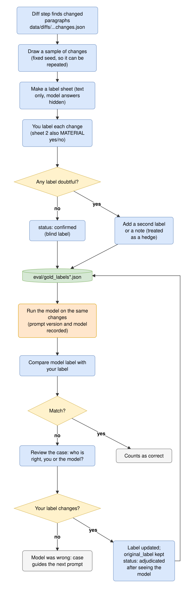
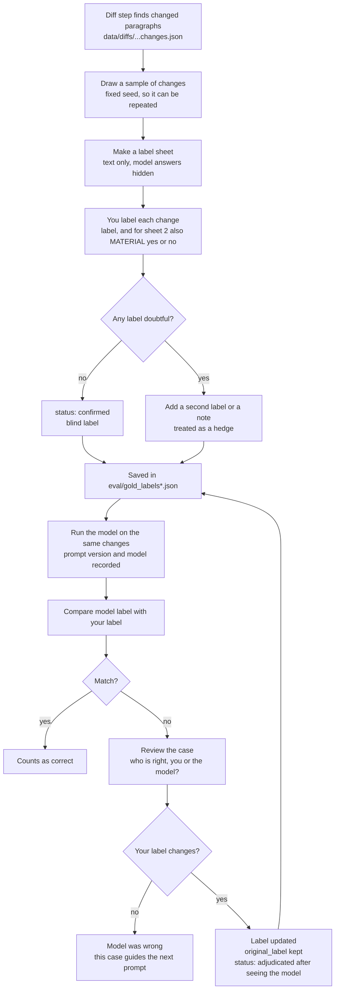
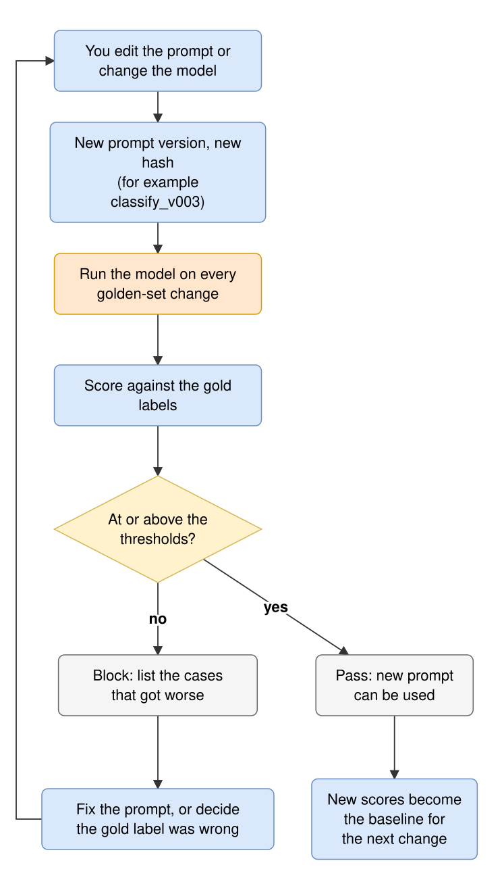
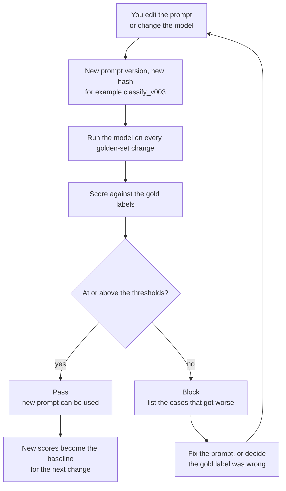

# The Golden Set

A golden set (also called gold labels or ground truth) is a collection of changes where a person has decided the correct answer. The pipeline's model answers are scored against it, so a prompt change can be checked before it is trusted.

Without it, "v002 looks better" is an impression. With it, it is a number.

---

## Why we need one

- The model gives confident answers whether they are right or wrong. Nothing in its output says which.
- Changing the prompt fixes some cases and can quietly break others. Reading the results by eye will not catch that.
- The golden set is the fixed yardstick. It stays the same while the prompt changes, so any score change comes from the prompt.

---

## How the golden set is built

Mermaid source for this diagram

---

## Using it when the prompt changes

This is the purpose of the set. The runner and thresholds below are **planned and not built yet**.

Mermaid source for this diagram

The score is compared with the previous version on the same cases. A prompt that fixes three cases and breaks four shows as worse, even if it feels better.

---

## What is in this project's golden set today

| File | Changes | How the labels were made |
|---|---|---|
| `eval/gold_labels.json` | 37 | 30 labeled blind (`confirmed`). 7 were changed after the labeler saw the model's answer (`adjudicated_after_seeing_model`); the original label is kept in `original_label`. |
| `eval/gold_labels_holdout.json` | 20 | All labeled blind. Each has a label, an optional second label, a MATERIAL yes or no, and an optional note. |

Both come from Apple's 2024 and 2025 10-Ks (accessions `0000320193-24-000123` and `0000320193-25-000079`). The 20 were drawn with seed 7 (13 modified, 4 removed, 3 added); the IDs are in `eval/holdout_ids.json`. The label sheets are `eval/label_sheet.md` and `eval/label_sheet_2.md`.

### Scores so far

| Prompt | Set | Result |
|---|---|---|
| v001 | first 37, 30 blind-labeled | 23/30 |
| v002 | first 37, 30 blind-labeled | 30/30 |
| v002 | fresh 20 | 13/20 exact label, 16/20 counting the second label, 10/20 on `is_material` |

---

## Why the two sets are kept apart

v002 was written after looking at the first 37, so its 30/30 only shows it learned those cases. The fresh 20 had not been seen, and the score there is lower. The fresh set is the honest number.

Rule: once a set has been used to tune a prompt, it stops being a fair test. Keep a set the prompt has never been tuned on, and refresh it when it has been used for tuning.

---

## Things that make a golden set weaker

- **Seeing the model's answer before labeling.** The label drifts toward the model. The 7 adjudicated labels are the example, which is why they are marked and left out of the blind score.
- **One labeler.** One person's reading of "material" is not a standard. The 50% materiality agreement on the fresh 20 suggests the definition is not yet shared.
- **Small size.** With 20 cases, one change moves the score 5 points.
- **Hedged labels.** A second label such as `risk_factor, non_material` means the labeler was unsure. The first label is scored. The second counts only for a lenient score and never decides a pass or fail alone.
- **Bare headings and stray bullets.** The text often does not support a call. `uncertain` is a valid gold label for those.

---

## Where it fits

The golden set is step 8 of [edgar_plan.md](edgar_plan.md) (the evaluation). See [pipeline_flowchart.md](pipeline_flowchart.md) for the pipeline that produces the changes being labeled.
