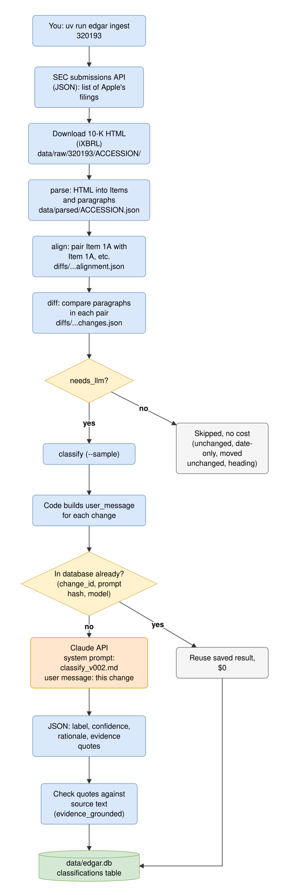
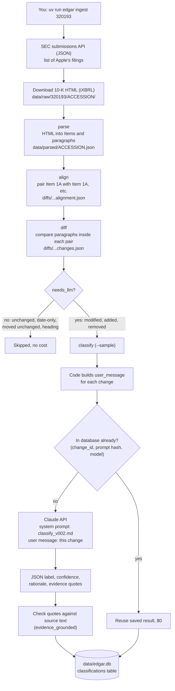
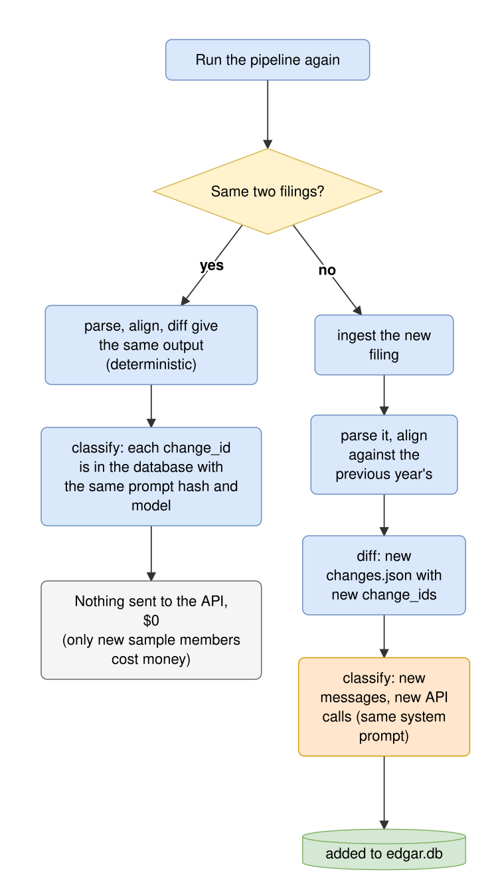
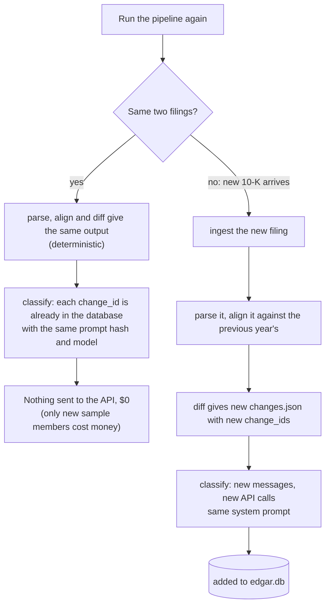

# Pipeline Flowcharts

How the pipeline runs for Apple (CIK 320193). Only the classify step calls the LLM. Everything else is plain code and costs nothing.

The diagrams are draw.io files in [diagrams/](diagrams/). They show in any Markdown preview, and with the "Draw.io Integration" VS Code extension you can open and edit them. The Mermaid source is kept under each image.

---

## First run: the whole pipeline



<details>
<summary>Mermaid source for this diagram</summary>



</details>

---

## What the diff files are

Both files are named `<old accession>__<new accession>` (older filing first). They come from deterministic code, contain no LLM answers, and cost nothing to produce.

| File | What it holds |
|---|---|
| `.alignment.json` | The section pairing. Each Item is `matched` (in both years), `added` or `removed`. It is the map of which sections to compare. |
| `.changes.json` | One record per changed paragraph: kind (modified, added, removed, moved), old and new paragraph IDs, old and new text, similarity, word diff, `needs_llm` and `skip_reason`. This is the work list for the LLM, and `build_user_message` reads it. |

---

## Second run

The system prompt (`prompts/classify_v002.md`) is the same file every run. What happens depends on what changed.



<details>
<summary>Mermaid source for this diagram</summary>



</details>

Two other things also trigger new API calls on the same filings:

- Editing the prompt file. The hash changes, so saved results no longer match.
- Switching the model.

---

# User message, iteration by iteration (Apple, 2024 vs 2025)

Both iterations use the same alignment and diff files: `data/diffs/0000320193-24-000123__0000320193-25-000079.{alignment,changes}.json`. The system prompt is `prompts/classify_v002.md` in both, and its SHA-256 starts `7c5723c8a8bc`.

The messages below were printed by `build_user_message` from the real `changes.json`, not typed by hand.

## Iteration 1: first run

The database has no result for these changes yet, so each message is sent to the API.

### Example 1: a modified paragraph

`change_id`: `chg-8ef88102649a`  (kind: modified, section: 10-K/3)

```text
Section: 10-K/3

Change: modified

<old_text>
On March 21, 2024, the U.S. Department of Justice (the “DOJ”) and a number of state and district attorneys general filed a civil antitrust lawsuit in the U.S. District Court for the District of New Jersey against the Company alleging monopolization or attempted monopolization in the markets for “performance smartphones” and “smartphones” in violation of U.S. antitrust laws. The DOJ is seeking equitable relief to redress the alleged anticompetitive behavior. In addition, various civil litigation matters have been filed in state and federal courts in the U.S. alleging similar violations of U.S. antitrust laws and seeking monetary damages and other nonmonetary relief. The Company believes it has substantial defenses and intends to vigorously defend itself.
</old_text>

<new_text>
On March 21, 2024, the DOJ and a number of state and district attorneys general filed a civil antitrust lawsuit in the U.S. District Court for the District of New Jersey against the Company alleging monopolization or attempted monopolization in the markets for “performance smartphones” and “smartphones” in violation of U.S. antitrust laws. The DOJ is seeking equitable relief to redress the alleged anticompetitive behavior. In addition, various civil litigation matters have been filed in state and federal courts in the U.S. alleging similar violations of U.S. antitrust laws and seeking monetary damages and other nonmonetary relief. The Company believes it has substantial defenses and intends to vigorously defend itself.
</new_text>

<word_diff>
replace: 'U.S. Department of Justice (the “DOJ”)' -> 'DOJ'
</word_diff>
```

### Example 2: a removed paragraph, with a closest-paragraph hint

`change_id`: `chg-5c49e50bf364`  (kind: removed, section: 10-K/1)

```text
Section: 10-K/1

Change: removed

There is no equivalent paragraph in the later filing.

<old_text>
The Company has entered into agreements for the supply of many components; however, there can be no guarantee that the Company will be able to extend or renew these agreements on similar terms, or at all.
</old_text>

<closest_paragraph_in_other_filing similarity="0.799" section="10-K/1" already_matched_to_another_paragraph="true">
The Company uses some custom components that are not commonly used by its competitors, and new products introduced by the Company often utilize custom components available from only one source. When a component or product uses new technologies, initial capacity constraints may exist until the suppliers’ yields have matured or their manufacturing capacities have increased. The Company has entered into agreements for the supply of many components; however, the Company may not be able to extend or renew agreements for the supply of components on similar terms, or at all, and may not be successful in obtaining sufficient quantities from its suppliers or in a timely manner, or in identifying and obtaining sufficient quantities from an alternative source. In addition, component suppliers may fail, be subject to consolidation within a particular industry, or decide to concentrate on the production of common components instead of components customized to meet the Company’s requirements, further limiting the Company’s ability to obtain sufficient quantities of components on commercially reasonable terms, or at all.
</closest_paragraph_in_other_filing>
```

## Iteration 2: second run, same two filings

The code rebuilds each message from the same `changes.json`. The result is character-for-character the same as iteration 1, so there is nothing new to show. Checked for both examples: **identical = True**.

- `chg-8ef88102649a`: message SHA-256 `f90cd3e5599c`; the database already holds a result for (change_id, prompt hash, `claude-sonnet-5-5`) with label `non_material`, confidence `high`, and stored input hash `f90cd3e5599c`.
- `chg-5c49e50bf364`: message SHA-256 `39103b15d170`; the database already holds a result for (change_id, prompt hash, `claude-sonnet-5-5`) with label `non_material`, confidence `high`, and stored input hash `39103b15d170`.

Because that result exists, `classify` skips the change: the message is built but **not sent**, and the cost is $0.

A different message appears only if the input changes: a new 10-K pair gives new `changes.json` rows, so new text goes into the same layout. Editing the prompt or switching the model does not change the message. It changes the cache key, so the same message is sent again and a new result is saved.
