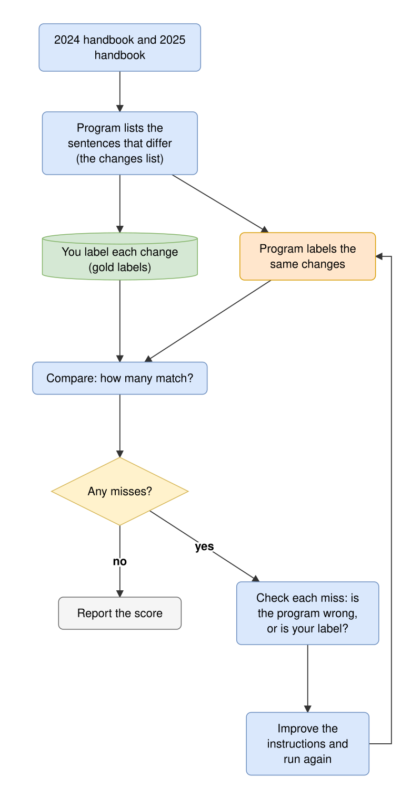
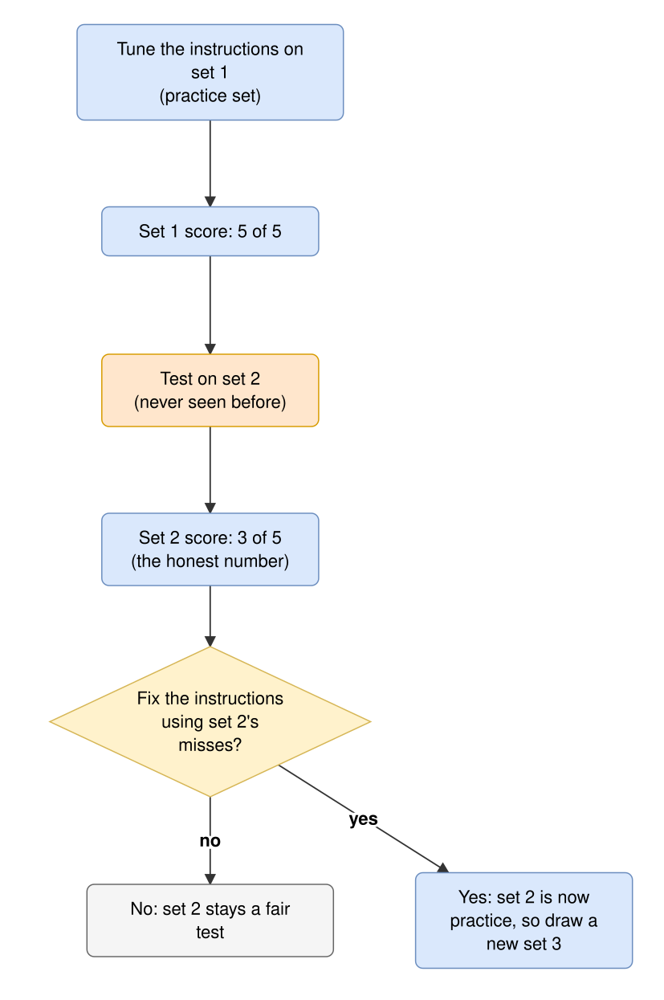

# Gold Labels, Explained With a School Handbook

The same idea as the project's golden set, with a handbook in place of Apple's 10-K filings. The sentences are made up.

A school publishes a handbook every year. You want to know what changed between 2024 and 2025, and which changes matter.

---

## 1. Find the changes

A program compares the two handbooks sentence by sentence. It lists only the sentences that differ. This list is the same kind of thing as `changes.json` in the project.

| # | Kind | 2024 sentence | 2025 sentence |
|---|---|---|---|
| 1 | modified | "School starts August 12." | "School starts August 11." |
| 2 | modified | "Late fee is $5 per day." | "Late fee is $15 per day." |
| 3 | removed | "Students may bring phones to class." | *(gone)* |
| 4 | added | *(none)* | "Students must wear ID badges." |
| 5 | modified | "Welcome to Maple School!" | "Welcome to Maple School." |

Sentences that are identical in both years are not in the list.

---

## 2. You write the gold labels

The categories are **Rule change**, **Fee change**, **Schedule change** and **Not important**. You read each change and write the right label. These are the **gold labels**, your answer key.

| # | Your gold label |
|---|---|
| 1 | Schedule change |
| 2 | Fee change |
| 3 | Rule change |
| 4 | Rule change |
| 5 | Not important |

---

## 3. The program labels the same changes

The program does not see your answers.

| # | Program's label | Matches? |
|---|---|---|
| 1 | Schedule change | yes |
| 2 | Fee change | yes |
| 3 | **Not important** | **no** |
| 4 | Rule change | yes |
| 5 | Not important | yes |

The score is 4 of 5, or 80%.

---

## 4. Check the misses, then improve and run again

For each miss, decide who is wrong: the program or your label. Here the program missed #3. It treated a removed sentence as unimportant, but you said it was a real rule change. So you fix the instructions with "a removed rule counts as a Rule change" and run it again on the same 5 changes. Now it scores 5 of 5.

Without the answer key you could only guess whether the change helped.

---

## 5. Why a second set is needed

You tuned the instructions on those 5 changes until they scored 5 of 5. That doesn't show the program works on other changes. You may have tuned it to those 5.

So you write 5 more changes the program has never seen, label them too, and test the final instructions on them.

| | Set 1 (used to tune) | Set 2 (never seen) |
|---|---|---|
| Score | 5 of 5 | 3 of 5 |

Set 1 says the program is perfect. Set 2 shows how it does on new material, so it is the number to trust.

A set stops being a fair test once you fix the instructions using its misses. At that point set 2 becomes practice, and you need a new set 3.

---

## How the example maps to the project

| Handbook example | This project |
|---|---|
| 2024 and 2025 handbooks | Apple's 2024 and 2025 10-Ks |
| the list of differing sentences | `data/diffs/...changes.json` |
| modified, removed, added | the same words in `kind` |
| Rule, Fee, Schedule, Not important | the eight labels (`risk_factor`, `non_material`, ...) |
| your answer key | `eval/gold_labels.json` and `eval/gold_labels_holdout.json` |
| the instructions you tweak | the prompt, `prompts/classify_v002.md` |
| set 1 (practice) | sample 1, 37 changes |
| set 2 (never seen) | sample 2, 20 changes |

The only thing the SEC data adds is scale: about 270 changes, not 5, so a sample is labeled by hand.

See [golden_set.md](golden_set.md) for how the project's golden set is built and used.
